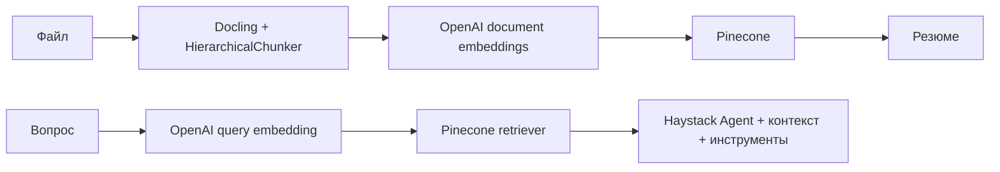

# Telegram-бот для поиска по документам

Учебный проект VPg07: Docling + Haystack + Pinecone + OpenAI-совместимый API.
Бот принимает PDF, DOCX, Markdown и TXT, создаёт фрагменты с метаданными,
сохраняет эмбеддинги в Pinecone, присылает краткое резюме и отвечает на вопросы с источниками.
Сохранены функции персонального ассистента: память сообщений, факт о кошках, фото собаки с анализом и текущая погода.

## Установка

Python 3.13. Создайте окружение в каталоге проекта:

```bash
python3.13 -m venv .venv
source .venv/bin/activate
pip install -r requirements-lock.txt
cp .env.example .env
```

Заполните `.env`. `OPENAI_BASE_URL` задаёт адрес прокси и используется для чата,
эмбеддингов и анализа изображений. Индекс Pinecone должен существовать и иметь
размерность 1536, метрику cosine. `ALLOWED_USER_IDS` - список Telegram ID владельцев
через запятую. Бот отвечает только этим пользователям в личном чате.

```bash
python main.py
python app.py ingest examples/service-policy.md
python app.py ask "Сколько стоит тариф Орбита?"
python -m unittest discover -s tests -v
```

Первый запуск обработки PDF загружает модели Docling. Эмбеддинги вычисляются
внешним API (`text-embedding-3-small`); Docling/OCR работает локально и может
потреблять значительные ресурсы. Нужен сетевой доступ к API и серверам моделей.

## Архитектура



`pipelines/builders.py` создаёт два настоящих Haystack Pipeline через
`add_component` и `connect`. `components/` содержит конвертер, запись, суммаризацию,
память и агента. `bot/telegram_bot.py` отвечает за транспорт. CLI использует тот же сервис.

## Поведение и ограничения

- Файлы до 10 МБ, PDF до 50 страниц, извлечённый текст до 120000 символов.
- Структурные чанки Docling дополнительно ограничены 1800 символами с перекрытием 150 внутри длинного чанка.
- Метаданные: имя файла, номер фрагмента, страницы при наличии, заголовки, SHA-256 файла.
- Пользователи изолированы по namespace; документы и история хранятся отдельно от VPg06.
- Повторная загрузка идентичного файла перезаписывает стабильные ID. Изменённый файл считается новым документом; старую версию можно удалить вместе со своей базой через `/clear confirm`.
- Резюме охватывает весь извлечённый текст через map/reduce; частичная ошибка API может оставить уже записанные фрагменты.
- `/help` - справка, `/clear` - инструкция, `/clear confirm` - очистка своих документов и памяти VPg07.
- Исходные загрузки временные; текст и эмбеддинги передаются внешним провайдерам. Используйте только разрешённые к передаче документы.
- Вопросный поиск использует пять ближайших фрагментов. Качество ответа и OCR зависит от документа и модели; полнота по всему архиву не гарантируется.
- Последовательная обработка рассчитана на учебную нагрузку; длинный документ временно задерживает другие сообщения.

В `examples/` лежат только вымышленные данные. Секреты, окружение, реальные документы,
локальный отчёт и снимки экрана не входят в репозиторий.

## Использованный опыт

VPf06 - память и ответы по файлу; VPg02 - Pinecone и эмбеддинги; VPg04 - источники и RAG;
VPg05 - повторная запись и метаданные; VPg06 - Haystack-агент и инструменты;
ANP09 - разделение загрузки и ответа, изоляция доступа; VPb03/VPb05 - модули и слои.

Документация: [Docling](https://docling-project.github.io/docling/),
[Haystack](https://docs.haystack.deepset.ai/), [Pinecone](https://docs.pinecone.io/).

## Проверка

На macOS arm64 / Python 3.13 выполнены пять локальных тестов и реальные загрузки
Markdown, DOCX, текстового PDF и PDF-скана. Проверены ответы с именем файла,
номером фрагмента и страницей PDF, отсутствие ответа на неизвестный вопрос,
повторная загрузка без увеличения числа записей и пустое хранилище другого владельца.
Через настоящий Telegram-клиент проверены загрузка файла, автоматическое резюме
и ответ со ссылками на фрагменты. Сканы в примерах содержат только вымышленные данные.

Для явного повторения платной интеграционной проверки:

```bash
python scripts/verify_live.py
```

Команда обращается к настроенным API и сохраняет локальные результаты в `var/`.
Включена совместимость со строковыми ID и объектами ListItem в SDK Pinecone.
Для `gpt-6*` в Chat Completions задан `reasoning_effort=none`, необходимый
использованному прокси при вызове инструментов.
